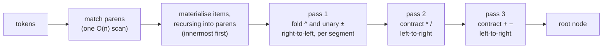
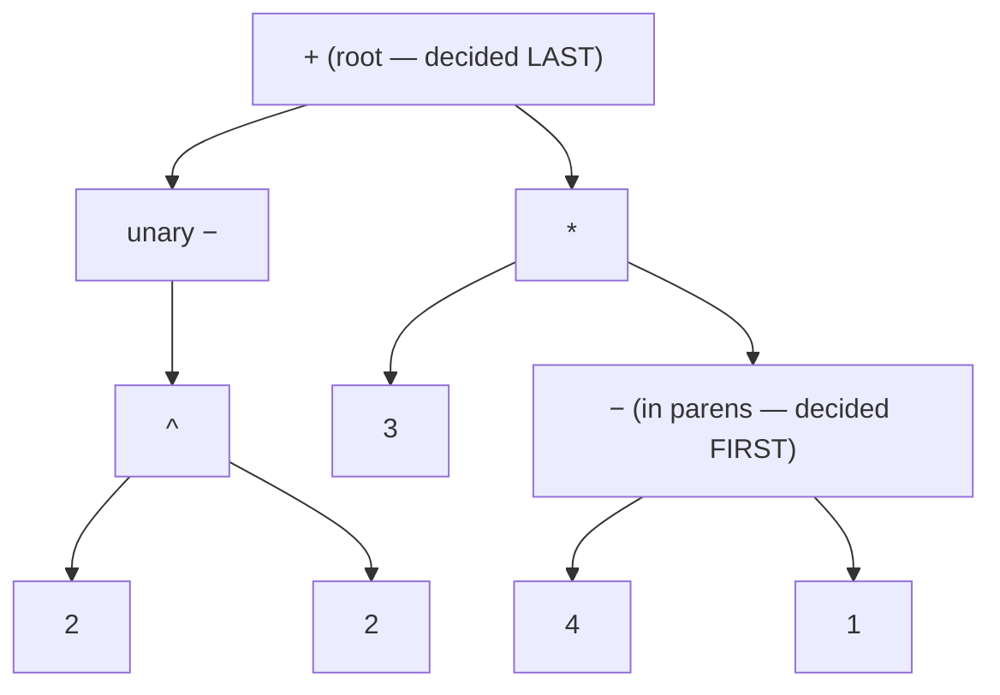
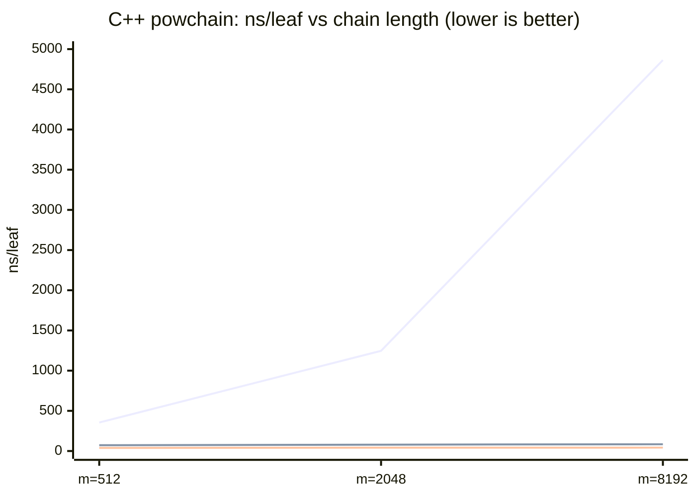

# `multipass-reverse` — bottom-up, one pass per precedence level

A **bottom-up** expression parser that reduces the *tightest-binding*
constructs first — deepest parentheses, then `^`, then `*` `/`, then `+` `-` —
until a single node remains: "multipass" in the original sense, **one
reduction pass per precedence level**, like a human simplifying on paper.

The two results, in one line each ([data](../FINDINGS.md)):
**vs the classics it is competitive** — its fused form
(`multipass-reverse-fold`, [below](#the-fused-variant)) is the fastest tree
builder of nine in C++, narrowly; in Python it leads narrowly at three of
four sizes and ties `ast-pratt` at the fourth; in Rust it ties
`ast-arena` from n=100 up; **vs its top-down family it is ahead on every tested input** — the only member
whose worst case is its average case.

Implementations: [C++](../cpp/src/multipass_reverse.cpp) ·
[Rust](../rust/src/reverse.rs) ·
[Python](../python/mathparser/evaluators.py) ·
[Haskell](../haskell/src/MathParser/Strategies.hs) (`reverseMpParse`).

## Top-down vs bottom-up

Classic `multipass` (and `multipass-arena`, `multipass-bfs`, `direct-mp`) is
**top-down** divide-and-conquer: scan for the *lowest-precedence* operator —
the root, evaluated *last* — split there, recurse. `multipass-reverse` is its
exact dual:

| | top-down (`multipass*`) | bottom-up (`multipass-reverse`) |
|---|---|---|
| first decision | the **root** (loosest-binding op) | the **innermost leaves** (tightest-binding) |
| mechanism | find split → recurse on halves | one reduction sweep per precedence level |
| per-level cost | scan candidates *per split* | **one pass, no scanning** |
| recursion | per split (depth ~ tree height) | per parenthesis group only |
| result | the same tree | the same tree, built in reverse order |

Both produce **numerically identical results** (construction order — and
hence arena node indices — differs, and no test in this repo compares node
counts or tree shape directly). Equivalence is enforced by the differential
fuzz suites ([C++](../cpp/tests/fuzz_differential.cpp) ·
[Rust](../rust/tests/fuzz.rs) ·
[Python](../python/test_fuzz.py)): every strategy must agree with every other
on thousands of random and mutated inputs.

## The pipeline



The working state is a flat list of **items**: `Opd` (number, variable, or
reduced subtree), `Un` (pending prefix sign), `Op` (pending binary operator).
A `*` `/` `+` `-` is a **barrier**: the moment one arrives, everything since
the previous barrier — a *segment* of operands, prefix signs and `^` — folds
to a single `Opd`. After the scan the list is `Opd (Op Opd)*` with only
`* / + -` left; two in-place passes (`* /`, then `+ -`) contract it to one node.

## Worked example

`-2 ^ 2 + 3 * (4 - 1)` — which is **5**, because `^` binds tighter than unary
minus: `-(2²) + 3·3 = -4 + 9`.

```text
tokens:   -  2  ^  2  +  3  *  (  4  -  1  )

materialise (recursing into the parens):
  items:  [un-  2  ^  2]                       ← segment so far
  '+' is a barrier → fold segment right-to-left:
          acc = 2;  see '^' → acc = 2^2;  see un- → acc = -(2^2)   = N
  items:  [N  +]                                ← new segment opens
  items:  [N  +  3]
  '*' is a barrier → fold segment [3] → 3       (lone operand: free)
  items:  [N  +  3  *]
  '(' → recurse on "4 - 1" → S = (4-1)          (same machinery, one level down)
  items:  [N  +  3  *  S]
  end → fold segment [S] → S

pass * / :  [N  +  M]        where M = 3*S
pass + - :  [R]              where R = N+M      ← the root

evaluate:  N = -4,  S = 3,  M = 9,  R = 5
```



Top-down multipass walks this picture from the root down; `multipass-reverse`
walks it from the parens up.

## Why fold segments right-to-left?

A segment is `un* opd (^ un* opd)*`, and the grammar has two corners:
`^` is **right-associative** (`2^3^2 = 512`) and binds **tighter than unary
minus** (`-2^2 = -4`, `2^-3 = 0.125`). Folding right-to-left makes both fall
out with no recursion or look-ahead — walking leftward you always hold the
fully-folded exponent in an accumulator:

```text
2 ^ -3 ^ 2   (reversed walk)        -2 ^ 2   (reversed walk)
acc = 2                             acc = 2
'^'  → acc = 3 ^ acc   = 3^2        '^'  → acc = 2 ^ acc = 2^2
un−  → acc = -(acc)    = -(3^2)     un−  → acc = -(acc)  = -(2^2)  ✓
'^'  → acc = 2 ^ acc   = 2^(-(3^2)) ✓
```

## Complexity — and the input family where bottom-up wins

Every token enters the item list once, every item is touched once per level
pass, and paren recursion partitions the input: **Θ(n) regardless of operator
structure**. The top-down family is usually fine too — but only thanks to two
fast paths (a flat-chain fold, and a prec-1 early exit in the split scan), and
each has an input that defeats it:

| input shape | `multipass` / `-arena` / `direct-mp` | `multipass-bfs` | `multipass-reverse` |
|---|---|---|---|
| random corpus (balanced) | ~Θ(n log n) | Θ(n log n) | **Θ(n)** |
| single-precedence chain `1+2-3+…` | Θ(n) (flat-chain fold) | Θ(n) | **Θ(n)** |
| mixed-precedence chain `b^e * b^e / …` (powchain) | **Θ(n²)** † | Θ(n log n) | **Θ(n)** |
| `^`-tower then `*`-run (towerchain) | **Θ(n²)** † | **Θ(n²)** † | **Θ(n)** |
| deep parens (nestchain — *bottom-up's* worst case) | Θ(n) | Θ(n) | **Θ(n)**, flat |

† Since patched in all four languages: scans bounded at 16 candidates with a
per-depth precedence-bucket fallback caps the family at **O(n log n)** —
[before/after numbers](../FINDINGS.md#result-2--vs-its-family-ahead-on-every-tested-input).
Bottom-up needs no budget and no fallback, because it never asks a question
whose answer lies elsewhere in the range.

Measured pre-fix on the neutral CI runner — the climbing line is quadratic
(ns/leaf ~4× per 4× length), the flat ones are not:



That was ~75–115× over top-down in C++ at m=8192 (~17× Python at m=1024, ~8×
Haskell at m=4096 — sizes differ, so ratios aren't cross-language comparable).
Post-fix the shipped binaries reproduce a ~1.4–3.5× gap on powchain (1.9–4.7× against
the fused form), still in bottom-up's favour, with no machinery on its side.

## Where it lands on the random corpora

Neutral runner, ns/leaf at n=1000 ([full tables](../FINDINGS.md#cross-language-results)):

| | C++ | Rust | Python | Haskell |
|---|--:|--:|--:|--:|
| fastest classic tree builder | `ast-arena` 58 | **`ast-arena` 66** | `ast-pratt` 2 257 | **`ast-rd` 464** |
| **`multipass-reverse-fold`** | **56** | **66** | **2 256** ¹ | 538 |
| `multipass-reverse` | 80 | 87 | 3 408 | 733 |
| best *top-down* multipass | `direct-mp` 83 | `direct-mp` 154 | `direct-mp` 4 139 | `multipass` 840 |
| fastest *no-tree* classic | **`direct-sy` 40** | **`direct-rd` 45** | `direct-rd` 2 116 | **`direct-rd` 463** |
| **`direct-reverse`** | **40** | 47 | **2 059** | 491 |
| *`direct-scannerless`* (lexer-free control) | *32* | *29* | *1 690* | *416* |

¹ Nested tuples in Python, like `ast-pratt`; an arena in the other three
languages ([TUNING.md](../bench/TUNING.md)).

Median of three CI runs on one CPU model (43227113612 / 43227138258 /
43231342538, AMD EPYC 9V74, all four languages from one commit, after the
[same-rules tuning pass](../bench/TUNING.md) and the fold-only pass;
rustc 1.98.1). The buffered form beats the top-down family in every
language. The fused form is the fastest tree builder in C++ (narrowly:
+3…+5 % over `ast-arena` at every size, positive in all 12 size×run
measurements), level with `ast-arena` in Rust (−1…+1 % at this size,
−1.4…+2.0 % over all sizes on this CPU, 4–5 % behind on the EPYC 7763),
level with `ast-pratt` in Python (−0.3…+0.9 % at this size, 5–8 % ahead of
the fastest classic at n=10 and 100) and fourth in Haskell, where both
pointer classics and `ast-arena` build faster. Its no-tree twin is level
with the fastest no-tree classic in C++ (−0.2…0 % vs `direct-sy` at this
size, +2…+3 % vs `direct-rd`), narrowly ahead of it in Python (+2…+3 % vs
`direct-rd` at this size, +13…+17 % at n=10 and 100), and behind
`direct-rd` in Rust (−6 %) and Haskell (−6 %). In C++ and Rust the fold
shares `ast-arena`'s two structural advantages — contiguous arena output
and no per-node heap allocation — and adds a third: no recursion.

## The fused variant

`multipass-reverse-fold` (tree) and `direct-reverse` (no tree) keep the
bottom-up order — deepest parens, then `^`/unary, then `* /`, then `+ -` — but
perform the level passes *on the fly* instead of over a buffered item list.
The observation: once a `^`/unary segment has folded on a barrier, what is
left of the grammar is two left-associative levels,
`sum := term ((+|-) term)*` and `term := seg ((*|/) seg)*`, and a bottom-up
reducer for that needs two accumulators with a pending operator each, not a
list. A `*` or `/` barrier closes the segment into `term`; a `+` or `-`
barrier closes `term` into `sum` as well; a `(` pushes the accumulators on a
frame stack and a `)` pops them. Consequences:

- **no recursion, no paren-match prepass, no per-level re-scan** — every
  token is read exactly once, in order, straight from the streaming lexer
  (no token array; one token of lookahead);
- the current operand lives in a register; the segment buffer is written only
  when a `^` or a prefix sign is actually pending (a signed leaf such as `-16`
  folds straight into the register: take the leaf, then look at the one token
  after it), so on ordinary input the parse runs entirely in `val` / `term` /
  `sum`;
- the scan alternates an *operand mode* and an *operator mode*, each with its
  own small dispatch — the same context recursive descent gets from its call
  structure, without the calls;
- worst case is still the average case: nothing ever looks for a split, and a
  nesting level costs one 24-byte frame push, where recursive descent spends
  ~5 call frames (`expr → term → unary → power → primary`).

Implementations: [C++](../cpp/src/multipass_reverse_fold.cpp) (one template,
two policies) · [Rust](../rust/src/fold.rs) ·
[Python](../python/mathparser/evaluators.py) (`reverse_fold_parse`) ·
[Haskell](../haskell/src/MathParser/Strategies.hs) (`reverseFoldParse`).

### Where it lands

Neutral 4-vCPU CI runner (structured shapes at m=8192; full tables in
[FINDINGS.md](../FINDINGS.md)), median of three CI runs
(43227113612 / 43227138258 / 43231342538, all on AMD EPYC 9V74;
rustc 1.98.1):

| C++, ns/leaf | `mp-reverse-fold` | `ast-arena` | `direct-reverse` | `direct-rd` | `direct-sy` | *`direct-scannerless`* (control) |
|---|--:|--:|--:|--:|--:|--:|
| random corpus, n=1000 | 56 | 58 | 40 | 41 | 40 | *32* |
| powchain (mixed precedence) | 27 | 30 | 20 | 22 | 22 | *21* |
| towerchain (`^` run then `*` run) | 28 | 29 | 16 | 17 | 17 | *15* |
| sumchain (single precedence) | 28 | 34 | 14 | 15 | 14 | *12* |
| nestchain (deep parens) | 27 | 38 | 21 | 40 | 18 | *20* |

The verdicts below use per-run ratios, as time saved against the rival
(1 − ours/rival). A margin that changed sign against an earlier same-CPU
batch whose code on both sides is unchanged makes the verdict a tie even
if this batch alone looks one-sided — see
[bench/results/](../bench/results/README.md).

Tree tier C++: the fastest tree builder on the random corpus (+3…+5 %
over `ast-arena`, positive in all 12 size×run measurements) and on every
structured shape, by 3–32 % depending on shape and run (towerchain the
narrowest, +3…+14 %; nestchain the widest, +23…+32 %). No-tree tier C++:
within ~3 % of `direct-rd` and `direct-sy` on the random corpus at
~40 ns/leaf — 2–3 % ahead of `direct-rd`, level with `direct-sy`
(−1.5…+0.3 %). On structured shapes, against `direct-rd` it is ahead on
powchain (+9…+10 %), towerchain (+8…+9 %) and sumchain (+7…+8 %), and
wins nestchain by 45–48 % (`direct-rd`'s recursion pays for the deep
nesting that `direct-reverse` never recurses through); against
`direct-sy` it is narrowly ahead on powchain (+8…+10 %), ties towerchain
and sumchain (+5…+7 % and +3…+4 % in this batch, but −1…0 % and −4 % on
2026-09-26), and loses nestchain (−21…−16 %).

Rust reproduces similar tiers, with the tuned `direct-rd` as the
exception. The fold is level with `ast-arena` on the random corpus
(−1.4…+2.0 % over the four sizes) and powchain (−1…+2 %), narrowly ahead
on towerchain (+6…+7 %) and sumchain (+2 %),
and clearly ahead on nestchain (+29…+34 %). `direct-reverse` loses to
`direct-rd` on the random corpus (−3 % at n=10, −5…−6 % above) —
`direct-rd` gained 7–10 % from the level-aware builder forms the C++ one
already had — but is ahead of it on every structured shape (+2 %
powchain, +12…+17 % towerchain, +14 % sumchain, +7 % nestchain), and
against `direct-sy` it wins every structured shape (+15…+27 %). The
random-corpus tree margin is hardware-dependent: on three EPYC 7763 runs
of the same commit the fold trails `ast-arena` by 4–5 %. Moving its stacks
from push/pop to pre-sized buffers indexed by locals, as in C++, did not
pay: the A/B gain on the corpus was matched by untouched strategies in the
same binary ([TUNING.md](../bench/TUNING.md)).

Python: after the same-rules tuning pass hand-inlined the classics (+5…+10 %
on the corpus), the fold had fallen behind `ast-pratt` (−8…−10 % at
n=1000). The fold-only pass found that most of that was the arena, not the
algorithm: a list of tuples indexed by int is no closer to the hardware
than nested tuples in CPython, only slower (`ast-arena` trails `ast-rd` by
the same margin). Built from nested tuples, like the classics, and with
one Python call skipped per barrier, the fold is level with `ast-pratt` at
n=1000 and 10000 (−0.3…+2.6 %) and 5–8 % ahead of the fastest classic at
n=10 and 100; on the structured shapes it ties `ast-pratt` on nestchain
(0…+2 %) and trails it on the other three (−13…−1 %). `direct-reverse` is
ahead of `direct-rd` at every size (+13…+17 % at n=10 and 100, +1…+3 %
above) and of `direct-sy` by 6–9 %; on the shapes it loses powchain to
`direct-rd` (−5…−3 %), is narrowly ahead on sumchain (+1…+3 %) and clearly
ahead on towerchain (+6 %) and nestchain (+10…+12 % over `direct-sy`,
+23…+25 % over `direct-rd`, whose call per grammar level per leaf is what
deep nesting multiplies). Haskell: the fold, like every arena form there,
trails the pointer classics, by ~1.1–1.2× up to n=1000 and ~1.3× at
n=10000 (~1.2× and ~1.4× before the shared arena carrier was made strict,
a change that lands on every arena strategy alike); `direct-reverse`
trails `direct-rd` by 2–10 % at every size, in every run, ties it on
powchain and sumchain and trails it by 1–12 % on the other two shapes.

The *pedagogical* `multipass-reverse` (buffered item list, three explicit
passes) stays in the suite because it is the version the walk-through above
describes; the fused form is the same algorithm with the passes interleaved.

## Scope and limits

The whole design targets one fixed, simple grammar: numbers, `+ - * / ^`,
unary ±, parens — four precedence levels. "One sweep per precedence level" is
tuned to exactly that and does not carry over for free to what real-world
parsers deal with: function calls of arbitrary arity, mixed associativity,
statements, or a language with a dozen-plus precedence levels (where the number
of sweeps grows with the level count). For those, recursive descent and Pratt
parsing stay the general-purpose default — they extend to a new construct by
adding a rule, where a per-level reduction does not. Everything measured here is
about the narrow expression-evaluation job; whether the bottom-up idea
generalizes beyond it is an open question, not a claim this repo makes.

## Implementation notes

Three things make the hot path fast (a rewrite measuring ~1.9× in C++, ~1.6×
in Python by interleaved A/B):

1. **One shared item stack** — each `reduceRange` works above its own base in
   one reusable vector and truncates on exit; recursion only per paren group.
2. **Fold-on-barrier** — segments fold right-to-left the moment a barrier
   closes them; a lone-operand segment (the common case) is a no-op.
3. **In-place level contraction** — the `* /` and `+ -` passes rewrite the
   list with a read/write index, allocating nothing.

The Haskell port gets the right-to-left walk for free: segments accumulate in
reverse order and `reduceSegRev` folds the reversed list directly.

## Reproduce

```sh
./build/adversarial_bench            # C++     (cmake --build build first)
cargo run --release --bin adversarial # Rust   (from rust/)
python3 python/adversarial.py        # Python
cd haskell && cabal run adversarial  # Haskell
```

Each prints all four shapes for all fifteen strategies. The shipped top-down
variants include the bounded-scan fix, so these reproduce the **post-fix**
gaps; the pre-fix numbers above are preserved from the last CI run before the
fix. Current numbers: [CI bench workflow](../.github/workflows/bench.yml).
